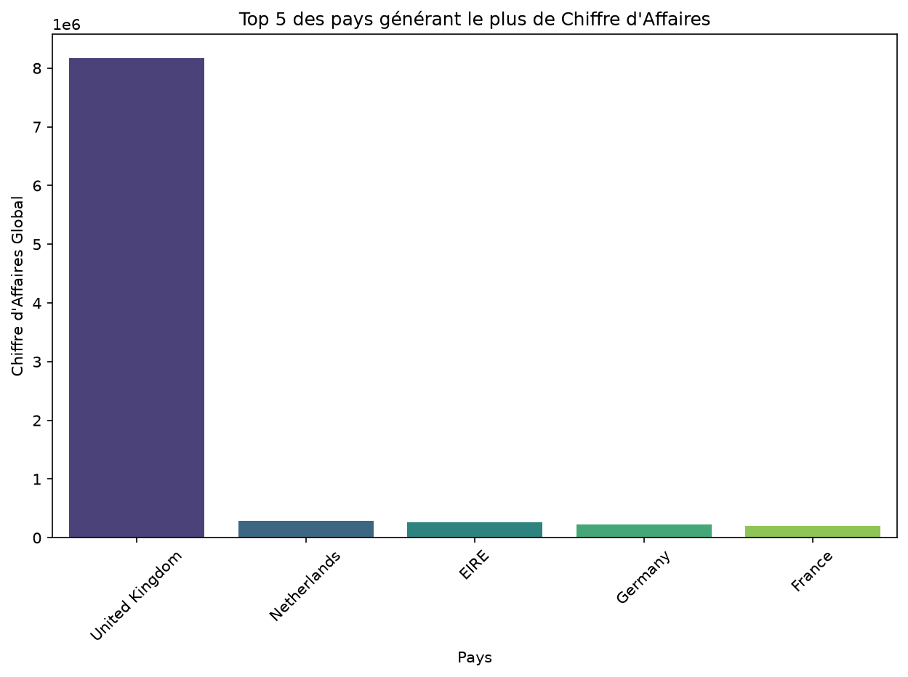
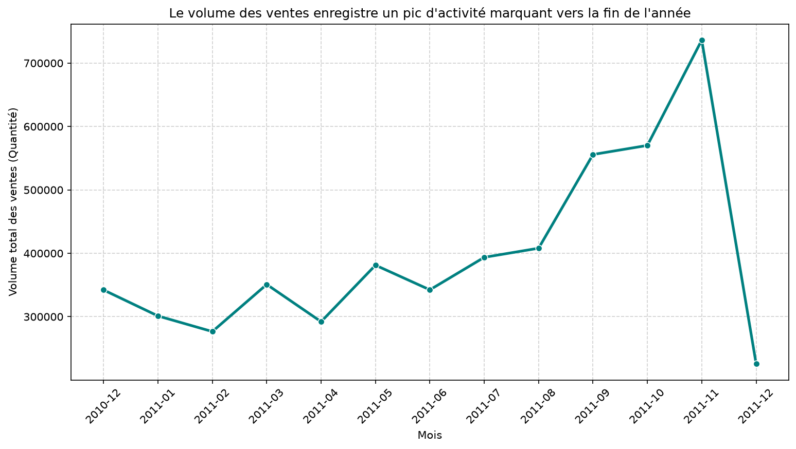
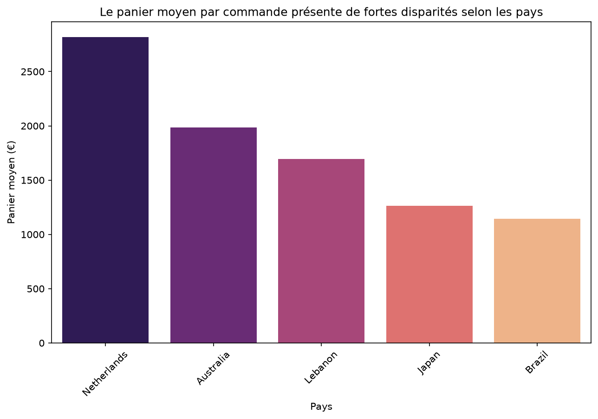
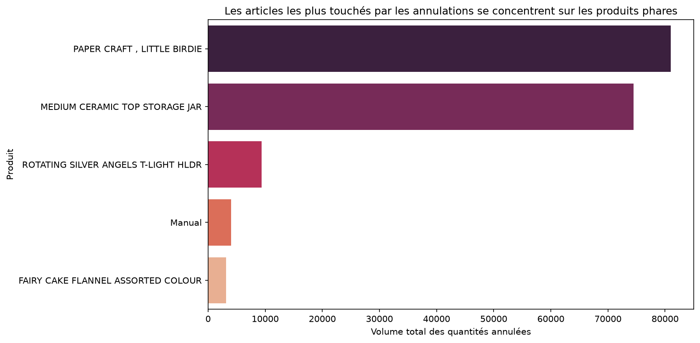

# Analyse Exploratoire de Données E-commerce (EDA)

## 🎯 La question étudiée
Ce projet réalise une analyse exploratoire d'un jeu de données de transactions e-commerce afin de répondre à plusieurs problématiques métier clés : l'identification des marchés les plus rentables, l'analyse de la saisonnalité des ventes, l'étude du panier moyen par pays et la compréhension des volumes de retours/annulations.

## 📊 La source des données
* **Source :** Jeu de données E-commerce provenance Kaggle ((https://www.kaggle.com/datasets/carrie1/ecommerce-data))
* **Période :** Données historiques de transactions sur une année glissante.
* **Licence :** Domaine public / Utilisation libre à des fins pédagogiques.

## 🛠️ Installation et ordre d'exécution
1. Cloner le dépôt :
   git clone <url-du-depot>
   cd mini_projet

2. Installer les dépendances :
   pip install -r requirements.txt

3. Ordre d'exécution des notebooks :
   Pour reproduire l'analyse de manière séquentielle, exécute les notebooks du dossier `notebooks/` dans cet ordre précis :
   - `1_inspection.ipynb` : Inspection initiale de la structure et des types de données.
   - `2_nettoyage.ipynb` : Traitement des valeurs manquantes, typage (conversion de la date) et nettoyage.
   - `3_analyse.ipynb` : Analyse exploratoire, requêtes métier et génération des graphiques.

## 📈 Principaux résultats

1. **Top 5 des pays par Chiffre d'Affaires :**
   Le Royaume-Uni domine massivement le volume des ventes et le chiffre d'affaires global, suivi à plus petite échelle par les Pays-Bas, l'EIRE, l'Allemagne et la France.
   
   

2. **Évolution mensuelle des ventes :**
   On observe une saisonnalité très marquée, avec une explosion du volume des transactions à l'approche de la fin d'année (pic en novembre), typique de la période des fêtes.
   
   

3. **Panier moyen par commande selon les pays :**
   L'analyse du panier moyen révèle de fortes disparités d'un marché à l'autre, démontrant des comportements d'achat hétérogènes selon la zone géographique.
   
   

4. **Analyse des annulations (Self-join) :**
   Grâce au croisement des données (factures commençant par "C"), l'analyse montre que les volumes de retours les plus élevés se concentrent logiquement sur les articles phares du catalogue, proportionnellement à leur popularité initiale.
   
   

## ⚠️ Les limites de l'analyse
* **Qualité des données brutes :** Présence de valeurs aberrantes ou de codes clients manquants qui ont nécessité un nettoyage.

* **Biais géographique :** Une forte surreprésentation du marché britannique qui déséquilibre l'analyse comparative internationale.
